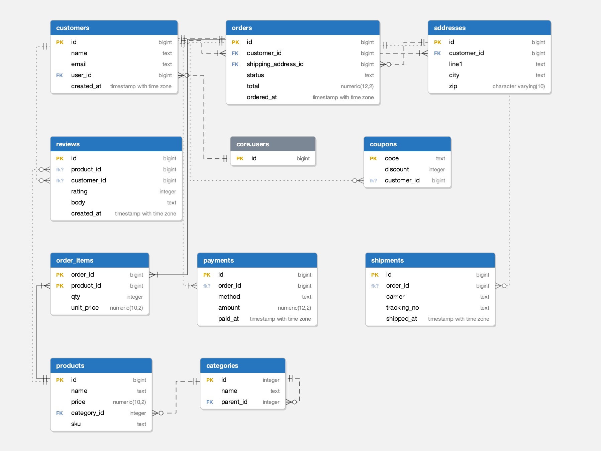
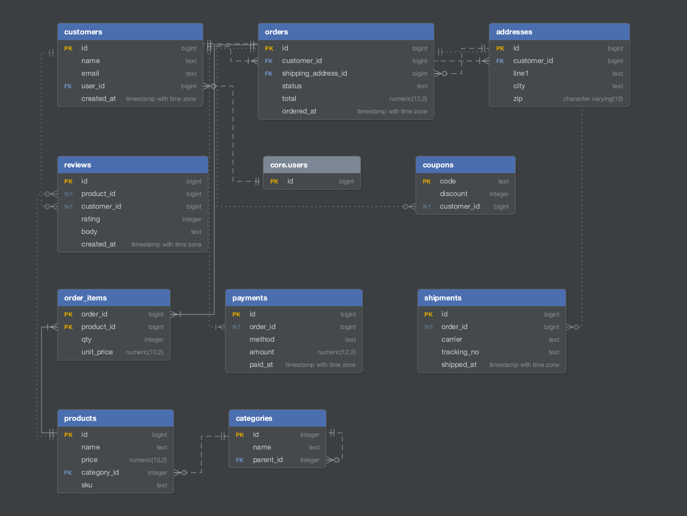
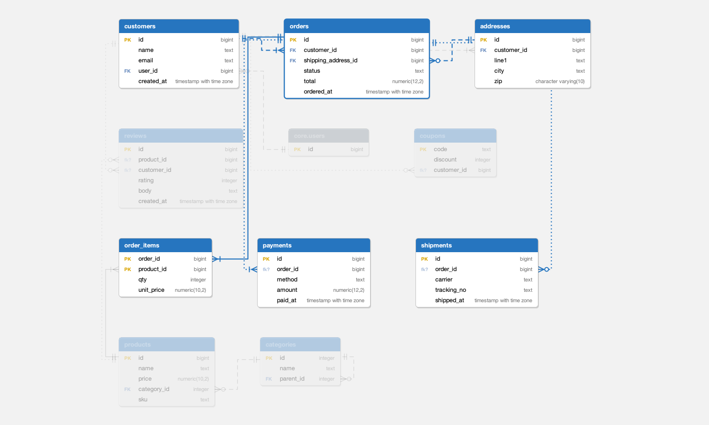

# PG Studio

PostgreSQL 전용 데스크톱 SQL 클라이언트입니다. JDBC로 접속하며, DataGrip과 비슷한 탐색기·SQL 콘솔·결과 그리드를 제공하고, 우측 패널에서 로컬 `claude` CLI로 쿼리 작성을 도와주며 내 Jira 미해결 이슈 목록을 보여줍니다.

Java 21 · Swing · FlatLaf · RSyntaxTextArea · pgjdbc

## 주요 기능

**접속 관리**
- 접속 프로필 저장/편집/삭제, 연결 테스트, SSL mode, JDBC URL 직접 지정
- 읽기 전용 접속(서버가 쓰기를 거부)
- 비밀번호는 기본적으로 저장하지 않고 연결할 때 입력받습니다. "비밀번호 저장"은 선택 사항입니다([보안](#보안-참고) 참고).

**DB 탐색기**
- 접속 › 스키마 › 테이블 / 뷰 / 머티리얼라이즈드 뷰 / 시퀀스 / 함수 › 컬럼(PK 표시)·인덱스 (지연 로딩)
- 우클릭: Select top 100, 행 수 세기, DDL 보기, 이름 복사, 새로고침

**ERD (스키마 우클릭 › ERD 보기)**
- 선택한 스키마의 테이블을 다이어그램으로 보여줍니다: 테이블 박스(컬럼, 타입, PK/FK 표시), 까마귀발 표기의 관계선, 자동 배치
- 관계선 모양: **실선** = 식별 관계(FK가 자식 PK의 일부), **점선** = 비식별 관계, **흐린 점선** = FK 제약은 없지만 이름으로 짐작되는 추정 관계(`customer_id → customers.id` 등, `fk?` 배지). 툴바에서 추정 관계를 끌 수 있습니다.
- 다른 스키마를 참조하는 FK는 참조 대상을 회색 헤더의 테이블로 함께 표시하고, 파티션 자식 테이블은 제외합니다.
- 박스 드래그 이동, 배경 드래그/휠 스크롤, Ctrl/Cmd+휠 확대·축소, 클릭 시 관계 강조, 더블클릭 시 해당 테이블 `select top 100`, 테이블 찾기, 컬럼 표시 수준(전체/PK·FK만/테이블명만), PNG 저장
- 추정 관계는 이름 기반 휴리스틱이라 틀릴 수 있습니다(부모 PK가 단일 컬럼일 때만, 같은 스키마 안에서만 추정).



<details>
<summary>다크 테마 / 테이블 선택(관계 강조) 샘플</summary>





</details>

**SQL 콘솔**
- 콘솔 탭마다 독립된 JDBC 연결과 트랜잭션 (DB 연결 없이도 열어서 작성/포맷 가능)
- 커서 위치의 문장 / 선택 영역 / 전체 스크립트 실행 (따옴표·주석·`$$` 블록을 인식하는 문장 분리)
- Explain / Explain Analyze, 실행 취소, Auto·Manual 커밋(Commit/Rollback), 최대 행 수 설정
- 구문 강조, 코드 접기, 스키마·테이블·컬럼 자동완성, 찾기/바꾸기, 주석 토글, 줄 복제, SQL 포맷
- `DROP`/`TRUNCATE`/WHERE 없는 `DELETE`·`UPDATE` 실행 전 확인
- 쿼리 이력(검색, 더블클릭으로 삽입), `.sql` 파일 열기/저장, 다크/라이트 테마

**결과 그리드**
- 정렬, 전체 컬럼 필터, NULL 표시, 셀 상세 보기
- TSV / CSV / JSON / INSERT 문으로 복사, CSV·JSON 파일 내보내기
- **그리드 직접 수정**: 단일 테이블 + PK를 모두 포함한 `select` 결과에서 셀 수정, 행 추가/삭제
  - 변경은 "변경 적용" 시 SQL 미리보기를 거쳐 실행되며, **항상 수동 커밋**입니다. 콘솔이 Auto commit이어도 트랜잭션을 연 채로 두고 Manual 모드로 전환하며, Commit을 눌러야 확정됩니다.
  - 한 번의 적용은 세이브포인트로 묶여 중간에 실패하면 이번 적용분만 롤백됩니다. 수정/삭제가 정확히 1행에 영향을 주지 않으면 중단합니다.
  - 조인, 수식 컬럼, PK 미포함 결과, 읽기 전용 접속은 수정할 수 없습니다.

**우측 패널 (Claude · Jira 탭, 열기/닫기: Cmd/Ctrl+Shift+J)**

*Claude 탭*
- 로컬 `claude` CLI(비대화형 `-p` 모드)로 질문하면 PostgreSQL 쿼리를 작성해 줍니다.
- 현재 에디터의 SQL(선택 영역 우선)과 스키마(테이블/컬럼 이름)를 함께 보고 답합니다. 각각 체크박스로 끌 수 있습니다.
- 제안된 쿼리는 **삽입** / **에디터 교체**(Cmd/Ctrl+Z로 되돌리기) / **복사** / **▶ 실행 (SELECT)** 버튼으로 사용합니다.
- "답변 쿼리를 콘솔에 자동 입력" 옵션(기본 켜짐)을 켜 두면 답변의 첫 SQL 블록이 현재 콘솔 에디터 끝에 붙고, SELECT면 읽기 전용 연결로 바로 실행되어 콘솔 결과 탭에 표시됩니다. 그 외 문장은 입력만 되고 실행되지 않습니다.
- 입력창: Enter 전송, Shift+Enter 줄바꿈

*Jira 탭*
- Jira Cloud(REST API v3)의 **내게 할당된 미해결 이슈** 목록을 `업무(이슈 키 + 제목) · 담당자 · 보고자`로 보여줍니다. 기본 JQL은 `assignee = currentUser() AND resolution = Unresolved ORDER BY updated DESC`이며, 탭 상단에서 JQL을 직접 수정하고 Enter로 조회할 수 있습니다(마지막 JQL은 기억).
- 이슈 키(파란 링크)를 클릭하거나 행을 더블클릭하면 기본 브라우저에서 열립니다. 우클릭으로 키 복사도 가능합니다.
- 설정 버튼에서 Jira 주소(`https://…`), 이메일, API 토큰을 입력합니다. 토큰은 입력한 Jira 주소로만 전송됩니다.

## 요구 사항

- JDK 21 (빌드 설정이 Java 21 toolchain을 요구하며 자동 다운로드는 설정되어 있지 않습니다)
- Gradle은 별도 설치가 필요 없습니다 (Gradle wrapper 포함)
- Claude 탭을 쓰려면 `claude` CLI가 설치되고 로그인되어 있어야 합니다. PATH와 일반 설치 위치에서 자동으로 찾고, 못 찾으면 파일 선택창이 뜹니다.

## 실행

```bash
./gradlew run            # Windows: gradlew.bat run
./gradlew installDist    # build/install/pg-studio/bin/pg-studio 생성
```

기본 `java`가 Gradle 래퍼(8.14)가 지원하지 않는 최신 JDK(예: 27)이면 `FAILURE: Build failed with an exception.` 아래에 `27.0.1.0.3` 같은 버전 문자열만 찍히고 실패합니다. 이때는 JDK 21을 지정해서 실행하세요.

```bash
JAVA_HOME=$(/usr/libexec/java_home -v 21) ./gradlew run    # macOS
```

매번 지정하기 번거로우면 `~/.zshrc`에 `export JAVA_HOME=$(/usr/libexec/java_home -v 21)`을 넣어 두세요.

macOS에서 개발·확인했습니다. Windows/Linux는 실행해 보지 않았습니다.

## 키보드 단축키

맥은 Cmd, 그 외는 Ctrl입니다.

| 단축키 | 동작 |
|---|---|
| Cmd/Ctrl+Enter | 선택 영역 또는 커서 위치의 문장 실행 |
| Cmd/Ctrl+Shift+Enter | 전체 스크립트 실행 |
| Ctrl+Space | 자동완성 (입력 중에도 자동 표시) |
| Cmd/Ctrl+/ | 주석 토글 |
| Cmd/Ctrl+D | 줄/선택 복제 |
| Cmd/Ctrl+Alt+L | SQL 포맷 |
| Cmd/Ctrl+Shift+U | 선택 영역 대문자 |
| Cmd/Ctrl+F | 찾기/바꾸기 |
| Cmd/Ctrl+= / - | 글꼴 크기 |
| Cmd/Ctrl+T | 새 콘솔 |
| Cmd/Ctrl+S | SQL 파일 저장 |
| Cmd/Ctrl+Shift+H | 쿼리 이력 |
| Cmd/Ctrl+Shift+J | 우측 패널(Claude/Jira) 열기/닫기 |

## 저장되는 데이터

| 위치 | 내용 |
|---|---|
| `~/.pgstudio/connections.properties` | 접속 프로필. "비밀번호 저장"을 선택한 접속만 비밀번호가 평문으로 들어갑니다. POSIX 환경에서는 파일 권한이 600입니다. |
| `~/.pgstudio/jira.properties` | Jira 주소, 이메일, JQL. "토큰 저장"을 선택한 경우에만 API 토큰이 평문으로 들어갑니다(POSIX에서 권한 600). |
| `~/.pgstudio/history.tsv` | 실행한 쿼리 이력 |
| Java Preferences | 테마, 글꼴 크기, Claude 패널 열림 여부, claude 실행 파일 경로 |

## 보안 참고

- **비밀번호/토큰 저장은 평문입니다.** DB 비밀번호와 Jira API 토큰의 "저장" 옵션은 테스트 용도로만 쓰세요. Windows에서는 파일 권한 보호가 적용되지 않습니다. 접속 정보 파일을 공유하거나 커밋하지 마세요.
- **Claude 탭은 외부로 데이터를 보냅니다.** 질문, 대화 맥락, (선택 시) 스키마 이름과 에디터 SQL이 로컬 `claude` CLI를 통해 Anthropic으로 전송됩니다. 쿼리 결과 데이터는 보내지 않습니다.
  - 앱을 켠 뒤 처음 보낼 때 확인창이 뜹니다.
  - 주민등록번호, 카드번호, 비밀번호·토큰·API 키로 보이는 문자열이 질문이나 에디터 SQL에 있으면 전송하지 않습니다. 패턴 기반의 보조 검사이므로 모든 경우를 잡지는 못합니다.
  - CLI는 모든 도구와 MCP를 끄고 세션을 저장하지 않으며 빈 임시 폴더에서 실행합니다. 프롬프트는 명령줄 인자가 아니라 stdin으로 전달합니다.
- **Claude 탭의 SELECT 실행은 서버가 강제하는 읽기 전용 연결**에서 이루어집니다(접속 프로필 설정과 무관). 단일 SELECT(WITH/VALUES/TABLE/SHOW)만 허용하고, 위험한 명령·함수가 들어 있으면 실행 버튼이 비활성화됩니다. 클라이언트 검사는 보조 수단이며, 최종 방어선은 서버의 읽기 전용 설정과 접속 계정 권한입니다. 쿼리당 제한은 30초, 최대 500행입니다.

## 테스트

```bash
./gradlew test
```

기본으로 실행되는 단위/헤드리스 UI 테스트와, 환경변수로 켜는 테스트로 나뉩니다.

| 환경변수 | 켜지는 테스트 |
|---|---|
| `PGSTUDIO_TEST_URL` | Postgres 통합 테스트 (접속, DDL 생성, 트랜잭션, 읽기 전용, 그리드 수정, 프로필 저장) |
| `PGSTUDIO_CLAUDE_SMOKE=1` | 실제 `claude` CLI 왕복 테스트 (중립적인 프롬프트로 실제 API를 호출합니다) |
| `PGSTUDIO_ERD_SAMPLE_DIR` | ERD 샘플 이미지 생성 (`PGSTUDIO_TEST_URL` 필요, `demo` 스키마를 읽음) |

Jira 테스트는 JDK 내장 `HttpServer`로 만든 가짜 Jira 서버를 사용하므로 실제 계정이 필요 없습니다. 테스트는 `user.home`을 `build/test-home`으로 격리해서 실제 `~/.pgstudio`를 건드리지 않습니다.

**통합 테스트 주의:** 반드시 **일회용 테스트 DB**에서만 실행하세요. 테이블을 만들고 지우며 행을 넣습니다. 비밀번호 없이 접속되는 DB(예: `trust` 인증)와 아래 시드 데이터가 필요합니다.

```bash
PGSTUDIO_TEST_URL="jdbc:postgresql://localhost:5432/postgres" ./gradlew test
```

<details>
<summary>시드 SQL (<code>postgres</code> 사용자로 실행)</summary>

```sql
create schema shop;
create table shop.customers (id bigint generated always as identity primary key, name text not null, email text unique, meta jsonb default '{}', created_at timestamptz default now());
create table shop.orders (id serial primary key, customer_id bigint not null references shop.customers(id), total numeric(10,2) check (total >= 0), tags text[]);
create index orders_cust_idx on shop.orders(customer_id);
create view shop.big_orders as select * from shop.orders where total > 100;
create function shop.add(a int, b int) returns int language sql as 'select a+b';
insert into shop.customers(name,email) values ('Kim','k@x.com'),('Lee',null);
insert into shop.orders(customer_id,total,tags) values (1,150.5,'{a,b}'),(2,20,null);
```

</details>

## 프로젝트 구조

`src/main/java/dev/pgstudio/`

| 파일 | 역할 |
|---|---|
| `Main`, `AppFrame` | 진입점, 메인 창(메뉴, 탭, 우측 패널 토글) |
| `Navigator`, `ConnectionDialog`, `ConnectionProfile`, `ProfileStore`, `Session` | 접속 관리와 DB 탐색기 |
| `ConsoleTab`, `SqlSplitter`, `SqlFormatter`, `History`, `HistoryDialog`, `SearchSupport` | SQL 콘솔과 에디터 기능 |
| `ResultPanel`, `ResultData`, `GridEdit` | 결과 그리드와 그리드 수정 |
| `Ddl` | `pg_catalog` 기반 DDL 생성 |
| `ErdPanel`, `ErdCanvas`, `ErdModel`, `ErdLayout`, `ErdInference` | ERD 탭 (읽기, 자동 배치, 관계 추정, 그리기) |
| `AiPanel`, `ClaudeCli`, `ChatParser`, `ReadOnlySql`, `SensitiveData` | Claude 탭 |
| `JiraPanel`, `JiraClient`, `JiraSettings`, `Browser` | Jira 탭 |
| `Fonts`, `Shortcuts` | 공통 유틸 |

## 아직 없는 기능

ERD 박스 위치 저장, SSH 터널, 별칭 기반 자동완성(`u.` 입력 시 `u`가 가리키는 테이블 컬럼), 비밀번호의 OS 키체인 저장.
